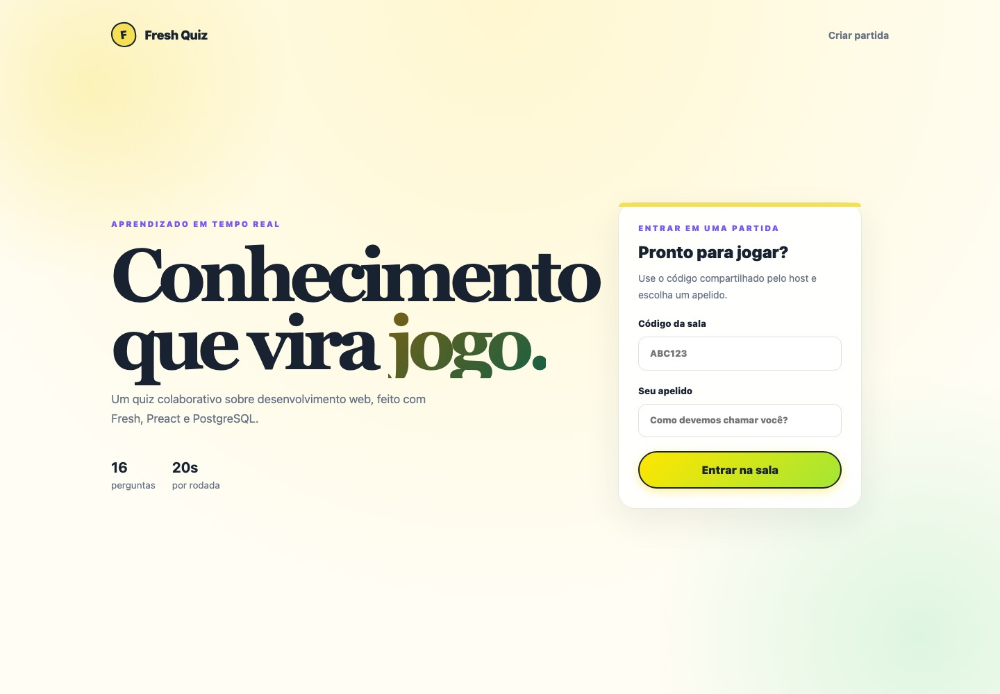
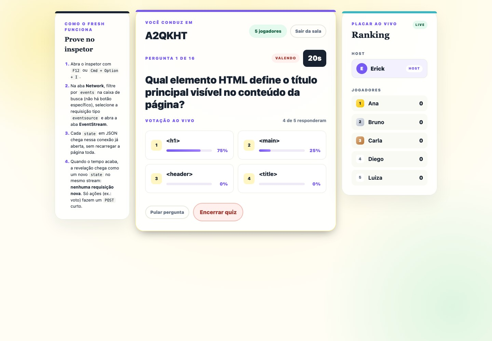
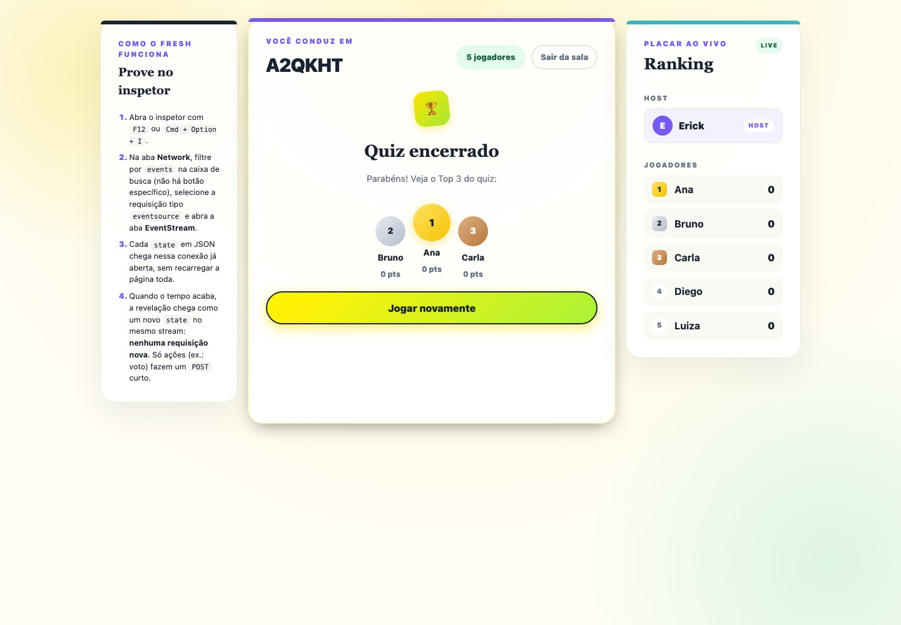
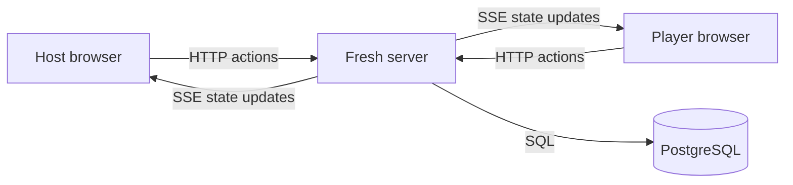

# Fresh Quiz — Fresh + Preact

A real-time multiplayer quiz about web fundamentals: create a room, share its
code, and compete with friends through timed questions and a live leaderboard.

**Status:** Playable learning project · Original Fresh/Preact implementation.

[](https://github.com/ErickHTF/freshQuiz/actions/workflows/ci.yml)
   

[Run locally](#run-locally) · [Development guide](docs/development.md) ·
[Architecture](docs/architecture.md) · [API reference](docs/api.md)



| Live voting — host view                                                                    | Final podium and ranking                                                   |
| ------------------------------------------------------------------------------------------ | -------------------------------------------------------------------------- |
|  |  |

_The game interface is in Brazilian Portuguese._

## Overview

Fresh Quiz brings a host and players together in a browser-based game. The
included quiz covers HTML, CSS, HTTP, JavaScript and APIs across 16 questions.

- Join a room by code and nickname, with separate host and player views.
- Answer timed questions with individually shuffled choices.
- Follow live voting and automatic answer reveals through server-sent events.
- Earn points for correct answers, with a bonus for speed.
- Replay with the same group, resetting answers and scores.

## Stack

| Layer        | Technologies                                   |
| ------------ | ---------------------------------------------- |
| Runtime      | Deno 2, TypeScript                             |
| Frontend     | Fresh 2, Preact, Preact signals                |
| Database     | PostgreSQL, SQL migrations                     |
| Real time    | Server-sent events (SSE), session cookies      |
| Verification | Deno test, formatting, lint, type checking, k6 |

## Run locally

Install **Deno 2+** and **Docker with Docker Compose**.

```bash
git clone https://github.com/ErickHTF/freshQuiz.git
cd freshQuiz
cp .env.example .env
docker compose up -d
deno install
deno task dev
```

Open [localhost:5173/host](http://localhost:5173/host) to create a room, then
[localhost:5173](http://localhost:5173/) in another browser session to join.
Database migrations and quiz questions load when the database container is first
created. The Angular version also uses database port `5433`; stop its database
before starting this version.

See the [development guide](docs/development.md) for database tasks and
deployment.

## Verification

```bash
deno task check
deno task test
deno task build
```

Keep PostgreSQL running to exercise database integration tests. See the
[load-testing guide](loadtest/README.md) for k6 scenarios.

## Architecture



Fresh serves the pages and API routes. Interactive Preact islands receive game
state through SSE and update the interface with signals. Server modules handle
game rules, SQL persistence and timed answer reveals.

The deployment guide documents a single EC2 instance with systemd and a local
PostgreSQL container. Restarting the app interrupts active games. Read the
[architecture guide](docs/architecture.md) for the source layout and game
lifecycle.

## Documentation

| Guide                                | Contents                                                   |
| ------------------------------------ | ---------------------------------------------------------- |
| [Development](docs/development.md)   | Requirements, local setup, configuration and test commands |
| [Architecture](docs/architecture.md) | Source layout and game lifecycle                           |
| [API reference](docs/api.md)         | Routes and session roles                                   |
| [Load testing](loadtest/README.md)   | k6 scenarios and execution instructions                    |

## Project context

This is the original implementation of Fresh Quiz. The
[Angular + Spring Boot version](https://github.com/ErickHTF/angular-spring-quiz)
explores the same game with a different stack while preserving its rules,
PostgreSQL schema and SSE approach.

No license is currently included in this repository.
